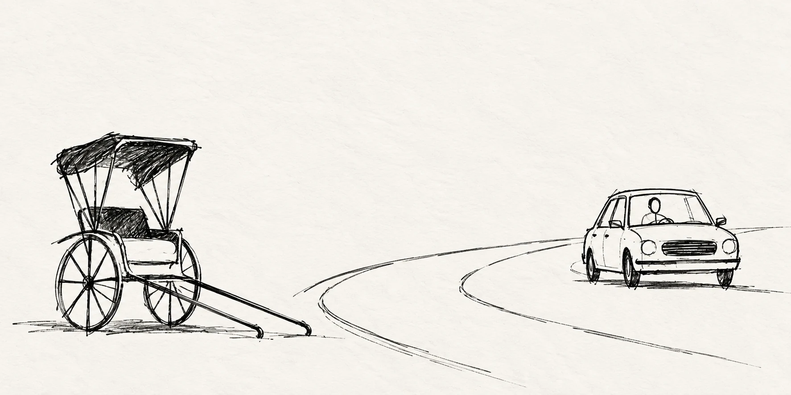
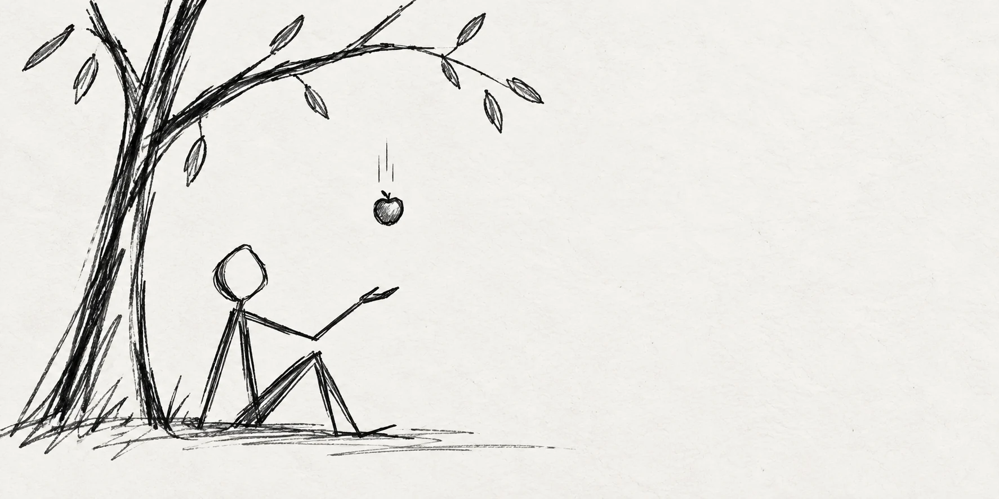
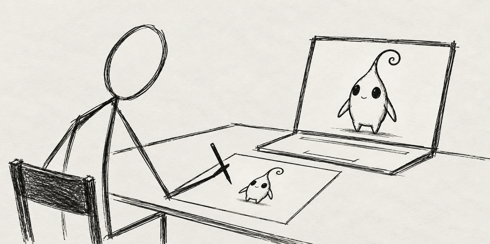

本文唯一的作用就是，让我们从铺天盖地的AI焦虑中跳出来，整装出发。

内容有些长，需要一点这个时代稀缺的**耐心**。

## 一、时代的洪流

作为AI应用的探索者，我的职责就是研究如何用AI替代重复性的工作。

最常听到大家说的一句话是：“你们用AI做了，我们做什么？”

而我想说的是：就像出租车淘汰了黄包车夫，哪怕140年前奔驰不制造汽车，也会有其他企业制造汽车。

**“谁也无法阻挡时代前进的脚步。”**

但，黄包车夫虽然消失了，出租车司机却遍地开花。

黄包车夫无法将乘客从北京送到海南。（或许理论上是可行的？）

出租车司机可以。

AI也是一样的，它带来的是生产力指数级提升，以及工作模式的改变。

就像黄包车夫要学开汽车一样，我们也要学AI，知道AI擅长什么，不擅长什么。

**不要一直想着AI会如何取代我，而是我如何驾驭AI提升生产力。**

当我们需要挖隧道时，都会使用盾构机，不会有人觉得自己徒手挖会比盾构机效率更高，也没有人因为非常擅长挖隧道而获得成长。

同样，在今天我们不应该和AI去比拼脑力，那就像我们要跟挖掘机比拼臂力。

也许**我们从来就不必超越什么**，而是要学会把属于机器的工作交给机器，

再去寻找属于人的不可替代性。

## 二、无法替代的“人”

**AI擅长什么？**

这个问题我从22年就在思考，每当我认为自己找到答案时，就会有新的技术出现，将我打击的一文不值。

虽然不想承认，但也不得不承认。

AI太强了，强到有时候我也会感到害怕。

**我寒窗苦读的学历，我引以为傲的经验，我赖以生存的技能。**

在它面前像是一个笑话...

被AI打击了无数次以后，有一刻我醒悟了。

人生过去几十年接受的教育，都在教导我如何成为一个更好的“机器”，我不断的学习、积累、实践，最终成为某个领域的专家。

我一直在学习前人的知识，在已有的框架体系内模仿，而这些，恰恰是AI所擅长的，它比我更会做机器。

**它拥有人类文明诞生以来所有的知识，它拥有最快最强的芯片做大脑，且永不疲倦。**

而我呢？仅仅是一段时间的996工作法，就足以让身体多个指标报警。

我就像一盏倔强的煤油灯，散发着最后昏暗的灯光，哪怕一阵微弱的风都足以让我熄灭。

而AI就像一颗太阳，它夺目的光芒让我无法睁开自己的双眼，望其项背。

**它真的是不可战胜的吗？**

那是1666年的秋天，在英国林肯郡的伍尔索普庄园中。因为伦敦大瘟疫而被困在家里的牛顿，此时正坐在一颗苹果树下发呆。

突然，一颗成熟的苹果从树上掉了下来，砸到了牛顿的头上，一下子就从发呆的状态清醒过来。牛顿捂着自己的头，生气的拿起苹果，刚准备丢出去的时候，他的脑海中突然闪过一个念头 —— **苹果为什么是掉在地上，而不是往天上飞？斜着飞？**

“一定是地球在吸引它！而且这个吸引力一定指向地球的中心！”

牛顿猛地一拍大腿，从地上蹦了起来，他兴奋极了，拿着苹果跑回自己的卧室，开始疯狂验算。

如果引力遵循“距离平方反比定律”（距离远2倍，引力弱4倍），那么地球拉月球的力，应该刚好能平衡掉月球绕地球转产生的“离心力”（或者说提供向心力）。他把“苹果下落的加速度”和“月球绕地的加速度”做了一个对比。

因为当时牛顿手里关于“地球半径”的数据是不准确的（当时公认的数据偏小），导致算出来的结果对不上。

可想而知，他很失落。认为自己的理论是错误的，于是就将手稿丢进了抽屉，转而去研究光学和炼金术了。

**这一年，牛顿才23岁。**

直到18年后的1684年，彼时的牛顿已经成为了人人敬仰的大物理学家，成为了剑桥大学的“招牌教授”。

当时著名的天文学家爱德蒙·哈雷（就是发现哈雷彗星的那位）专程去剑桥拜访牛顿。

哈雷问了一个困扰当时所有科学家的问题：“如果太阳对行星的引力是与距离平方成反比的，那行星的运行轨道应该是什么形状？”

牛顿不假思索道：“椭圆。”

哈雷当时震惊的问牛顿：“你怎么知道的？”

牛顿淡定的说：“我以前算过。”（正是18年前那次计算）

哈雷让他把计算手稿拿出来，结果牛顿找不到了。

于是牛顿答应哈雷，重新写一份证明寄给他。

这一次，牛顿拿到了法国天文学家皮卡尔测定的更精确的地球半径数据。

终于得到了自己想要的答案，证明了万有引力的存在。

1687年，43岁的牛顿出版了人类科学史上最伟大的著作——《自然哲学的数学原理》，提出了牛顿三大定律。

从1666年被苹果砸到，再到真正证明并发表，牛顿用了21年。

那一天的灵光乍现，以及后来的再次验证，建立了人类物理学的根基。

假如我们回到1666年，看到苹果落下的不是牛顿，而是AI。

它不会想到 **“苹果为什么是掉在地上，而不是往天上飞？斜着飞？”**

更不会跨越20年之久的时间，把当初错误数据导致的错误结果修正。

现在的AI做不到，将来的AI也不可能做到。

因为它并不具备真正意义上像人类那样的思考能力，无论是它的思考还是深度推理，本质上都是计算机的数学运算。

它没有真正意义上的创造能力，一切的认知都基于人类当前对宇宙和世界的认识，所有的创造都是在已有的东西上进行加工。

但人不一样，当我们思考的时候，大脑的神经元会以每秒钟 1000万亿到 1亿亿次的信号传递。

那突如其来的灵感只是一瞬间，AI永远无法模仿。

**可以被替代的是做“机器”工作的人，而不可替代的是人。**

## 三、创造力、想象力、表达力

这是我们每个人刻在基因遗传链最深处的三种能力，与生俱来，这是宇宙上亿年神奇演变的结果，任何科技手段都无法模仿。

在今天，我们可以让AI来 **“画一张你认为最特别的外星人的照片。”**

如果这篇文章有一万个读者，每个人都让AI执行这个指令，最终我们会发现大家的外星人好像长得都差不多。

但假如我们把同样的指令交给一万个人，或许这中间就有一些让人眼前一亮，好像从来没想过，也从来没见过的外星人模样。

“灵光乍现”，这是一个很玄妙的概念，它既不是单纯的随机，又不是刻意的模仿。

比如我今天决定出门，出到一半我突然不想出了我就回屋，回到一半我又想出了，出到一半我又不想出了，回到一半我又想一边跳着探戈一边出，跳到一般我又想换成芭蕾。（这个人得神经到什么样，才能做出这些诡异的事情...）

但这就是人，独特的人。

永远不要小瞧灵光乍现的力量，**人类所有伟大的发明，几乎都源于灵光乍现**。

AI可以取代设计师，但它取代不了人类设计师灵光乍现的一次改动；让整个作品更有吸引力。

AI可以取代程序员，但它取代不了人类程序员灵光乍现的一次提交；让整个系统的性能大幅度提升。

AI可以取代医生，但它取代不了人类医生灵光乍现的一个发现；找到了患者多年隐疾的根源。

AI可以取代运营，但它取代不了人类运营灵光乍现的一个想法；让整个ROI成倍提升。

...

创造力、想象力、表达力，这是我们最核心的竞争力，也是最应该提升的。

设计师应该思考更美好的作品，告诉AI，让它生成出来。

程序员应该思考更健壮的架构，告诉AI，让它生成出来。

律师应该思考卷宗背后的蛛丝马迹，告诉AI，让它找出来。

朋友们，如果你能看到这里。我想请你对自己说一声 “感谢”。

在这个看视频都要3倍速的时代，你拥有一个像宝石般稀缺的东西 —— **耐心**。

如果你还想改变什么，不要犹豫，选择任何一个你觉得顺手的AI：

千问、豆包、元宝、Kimi、Deepseek、Gemini、ChatGPT....

用起来。

然后不断强迫自己**思考问题的本质**，将你的思考告诉AI，然后再根据AI的结论思考，再把你的思考告诉AI。

如此反复。

多去记录生活中的美好，去看美好的事物，锻炼表达美好事物的能力。

AI的能力对所有人都是固定的，唯一能拉开差距的是人。

所有的设计师都可以用AI设计图片，有的设计师脑海中立马就能浮现出一副优美的作品，并将这个画面准确的描述给AI，最终得到这个作品。

有的设计师脑海中什么内容都没有，直接让AI去做，最终的结果只能是不满意，认为AI太垃圾，不再用AI。

所有的程序员都可以用AI写代码，有的程序员会在一开始将整个项目的结构设计好，编码规范写好，再让AI根据自己的架构一步一步去实现。

有的程序员上来就让AI去做，错了改，改了错，最后坑坑巴巴上线，也只是不断的在叠加“屎山代码”。

看似一时的高效，带来的是未来长久维护的痛苦。

**去吧，朋友们。**

**去思考、去发现、去创造。**
