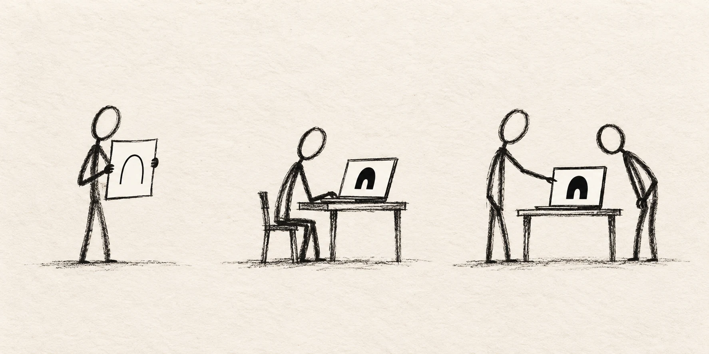

本篇为 Felix Rieseberg 文章的简体中文译文。文中的“我”指原作者。

这个月，我让传统编程面试寿终正寝了。作为 Anthropic 的一名招聘经理，我不再要求候选人参加这类面试。它曾经很有用：能否快速定义问题、找到优雅的解决方案，虽然只是一个较弱的指标，却能帮助预测你在我的团队里会有多成功。在真实代码中完成小型编程挑战，的确能让我们了解候选人的一些重要特质。

现在，这已经不成立了。给你一道小型 React 编程题，已经和考别人汇编知识一样没什么意义；Claude 在这两方面都更擅长。我们那些最有影响力的构建者，无论这类测试成绩如何，都能取得成功。

编程面试虽然无处不在，却从未受欢迎。我怀疑，即使只是因为它的消失反映出我们角色的演变，已经站稳脚跟的工程师仍然会对此产生强烈反应。关于 AI 如何给初级开发者，尤其是正在找工作的人带来挑战，已经有很多文章讨论了。如今，看了一段时间初级同事如何使用 AI 之后，我有了一个更乐观的看法：你能产生多大影响，越来越不受你在框架和库上积累了多少年知识的限制。

我看到一些相对新来的工程师，飞速超过了那些可能更擅长写代码、也已经做了更久的人。进取心胜过资历。

这篇文章是我给初级工程师最诚恳的建议，不过“初级”这个词并不准确。它真正面向的，是那些缺少社会资本、地位或权力的工程师。

## 有想法，却没有话语权

首先，要知道自己的优势和劣势。

新鲜的眼光，哪怕是天真的眼光，长期以来都被认为很有力量。我加入 Stripe 时，创始人 Patrick Collison 恳请我们这些新人，密切留意那些让我们觉得奇怪的事。他相信，新人会发现那些老员工早就习以为常、不再留意的阻力和机会。

1991 年，James March [写道](https://doi.org/10.1287/orsc.2.1.71?ref=felixrieseberg.com)，组织依赖于“持续引入天真而无知的人”。有人问 Orson Welles，他哪来的信心去尝试从未有人拍过的镜头时，他[说](https://www.themarginalian.org/2012/04/30/orson-welles-on-ignorance-1960/?ref=felixrieseberg.com)：“无知，纯粹的无知。你知道，没有什么能给你同样的信心。我觉得，只有当你对一个行业有所了解时，你才会胆怯或谨慎。”

我加入 Notion 时，有一轮面试要求设计离线模式的架构。听说他们把这当作一道“陷阱”面试题时，我很困惑，因为他们认定离线模式是不可能实现的。数据模型太复杂，很难轻松同步整个 Notion 工作区；而只下载单个页面，又被认为是 CEO Ivan Zhao 绝不会允许的用户体验。后来证明，数据模型的复杂性确实存在，但创始人的反对并不存在。大家把它当成了常识，以至于根本没人核实。我这个无知的新人，什么也不懂，只知道直接去问。

读到这样的故事，很容易觉得是别人做了糟糕的决定。但当做出这些决定的人就是你自己时，要发现其中的错误究竟有多难，我怎么强调都不为过。加入 Notion 不久，我想给团队配上大电视，用来展示实时仪表盘。我撞上了组织里的层层阻力，没有做成，也没有在意到愿意为此大动干戈的程度。

一年后，[Ji Pei](https://www.linkedin.com/in/ji-pei?ref=felixrieseberg.com) 作为新员工加入，也有同样的想法。我嗤之以鼻，告诉他别费劲了；我已经试过。他却已经去问了。第二天，电视就送到了。就在那一年里的某个时候，我变成了老员工。

这种由无知带来的力量只有一个问题：没人在乎你怎么想。大多数科技公司都有层层中层管理者，把更宏观的业务目标转化为执行。从结构上看，公司往往围绕少数人来建立，由他们批准或否决一个个想法。在执行成本很高的世界里，通常你得费力爬到某种社会地位，整个组织才会愿意在你的想法上“赌一把”。组织架构的变化往往慢得像冰川，因此，即使是相信 AI 的公司，也常常只期待初级员工更快地完成任务，而不是雄心勃勃地追求业务目标。

不过，好消息来了：执行已经不再昂贵。

## 该怎么做

(1) 优先考虑业务影响，而不是待办任务：在 AI 编程尚未出现的 2011 年，Patrick McKenzie [写道](https://www.kalzumeus.com/2011/10/28/dont-call-yourself-a-programmer/?ref=felixrieseberg.com)，[“雇用工程师是为了创造业务价值，而不是编写程序。”](https://www.kalzumeus.com/2011/10/28/dont-call-yourself-a-programmer/?ref=felixrieseberg.com)他建议，让自己靠近公司里赚钱的部分。从这里开始：理解你的公司到底想实现什么（如果公司较大，就理解你所在的小组或部门想实现什么）。然后找到合适的高度——理解你上级的上级有什么目标，往往是一个有用的参照。

(2) 选一个大胆的想法：提出几个想法，假如成功，就能大幅提高组织实现那些目标的机会。要有雄心！

(3) 用一个周末把它做出来：我见过小团队和独自工作的工程师，直接做出能运行的原型，从而飞速越过通常那些写产品需求文档（PRD）、争取认同，以及游说设计师或产品经理投入时间的流程。

(4) 聚焦一个好想法：以我的经验，初级同事经常犯的错误，是把多个想法塞进同一个原型，把三个好点子藏在二十个坏点子中。如果你的原型需要创造一门新编程语言、一个后端，不知怎么还得加上移动应用，你是不会成功的。做出可运行原型的目的，是把一个想法表达得足够清楚，让领导层迅速理解其中的机会，也明白你就是能把它推进下去的人。

(5) 充分发挥你的新视角：如果你做的是面向用户的东西，你对用户有一份独特的同理心，因此更能体会产品对他们而言哪里好用、哪里不好用。我在 Slack 和 Notion 的同事，很难真正体会一个外部用户使用 Slack 或 Notion 是什么感受。

如果你做的是基础设施或工具，你的优势在于：你从未学过那些事情为什么被认为“不可能”的种种理由。

## 未来是光明的

我不认为编程面试还会回来。想到有那么多人曾为了找到好工作、拥有更好的未来，而买下一本本《算法与数据结构》，很容易让人感慨；又或者，编程面试的消亡，标志着软件工程达到了一个新的抽象层次。

与此同时，作为一个长期厌恶论资排辈式晋升的人，我又忍不住感到乐观。我已经见过不少以这种方式做出来的热门应用和产品。

在 Anthropic，大家太习惯把 Claude Code 当作命令行界面（CLI）使用了，以至于最后是两位加入时间相对较短的工程师（[Anthony Morris](https://x.com/amorriscode?ref=felixrieseberg.com) 和 [Alice Zhao](https://x.com/alicelovescake1?ref=felixrieseberg.com)），用一个周末迅速做出了能运行的原型。大约八天后，第一个公开版本就发布了。听说一个好用的 Claude Code 图形界面成了很受欢迎的产品，你应该不会惊讶。

我可能不是唯一一个正在琢磨如何面试、找出那些善于借助 AI 构建产品的人的经理。我还没有完全摸索出办法——但我正在简历和作品集中寻找那些能体现品味、同理心和有原则的思考的小原型。如果你已经想出了更好的方法，我很想听听。

## 原作者与转载说明

原作者：**Felix Rieseberg**。原文：[Hunger beats tenure: Advice for junior engineers](https://felixrieseberg.com/hunger-beats-tenure-advice-for-junior-engineers/)，发表于 **2026 年 10 月 27 日**。

本文为原文的简体中文翻译转载，于 **2026 年 10 月 28 日**刊载于本站。文中的第一人称、经历和观点均属于原作者；本站负责翻译与编排。

本站配图为本次转载另行制作。
